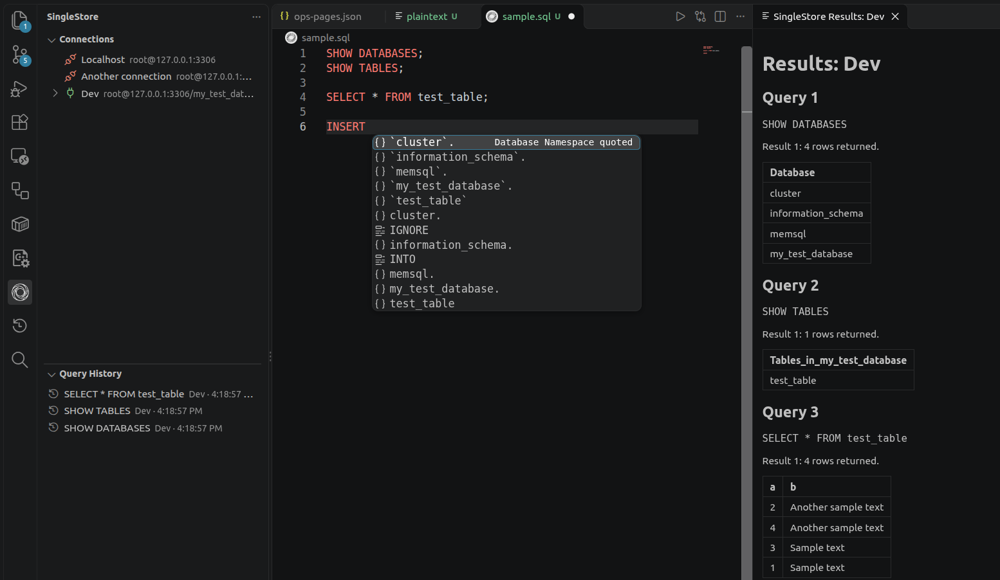
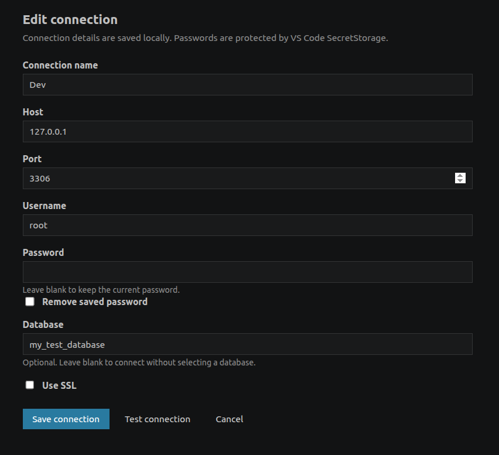
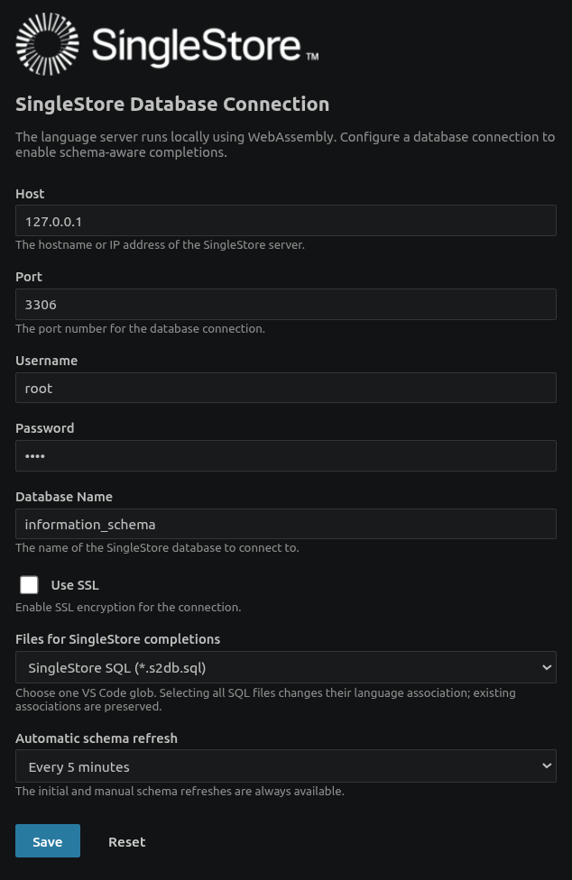

# SingleStore Client for VS Code

A fully functional [SingleStore](https://www.singlestore.com/) database client for Visual Studio Code. Manage connections, execute SQL, browse database schema, and write queries with syntax highlighting and code completion without leaving the editor.

## Features

- **Connection management:** Add, test, edit, and delete named connection profiles in the SingleStore Activity Bar view. Passwords are stored in VS Code SecretStorage.
- **Query execution:** Run selected SQL or the statement at the cursor, view results in a new tab, and re-execute queries from session history.
- **Schema visualization:** Browse databases and their objects, along with connection-level metadata, in the object explorer.
- **SQL editing:** Use grammar and schema-aware completions and customizable semantic syntax highlighting.

## Installation

1. Download the `.vsix` file from the [Releases](https://github.com/singlestore-labs/singlestore-vscode/releases) page.
2. In VS Code, open the Command Palette (`Ctrl+Shift+P`, or `Cmd+Shift+P` on macOS) and run **Extensions: Install from VSIX…**.
3. Select the downloaded `.vsix` file.

Alternatively, search for **SingleStore Client** in the VS Code Extensions view (`Ctrl+Shift+X`, or `Cmd+Shift+X` on macOS).

## Requirements

- VS Code 1.85 or later.
- A reachable SingleStore database and credentials to run queries and use schema-aware features. The account needs permission for the language server's `INFORMATION_SCHEMA` and `SHOW` queries.

No separate language server, Go installation, or language-server TCP/WebSocket endpoint is required. Grammar-only completions work without a database connection.

## Getting started

1. Select the stylized **SingleStore** icon in the Activity Bar and choose **Add Connection**.
2. Enter a name, host, port, username, and optional password and database. Enable SSL if needed. Use **Test connection** to check the details without saving them, then save the profile.
3. Click the profile in **Connections** to make it active. Expand it to browse its schema after the initial metadata refresh.
4. Open a file matching `*.s2db.sql` for completions and highlighting. Select SQL or place the cursor in a statement, then press **Ctrl+Enter** (**Cmd+Enter** on macOS) to execute it.

## Connections

Use the **Connections** view to add, connect, disconnect, edit, or delete profiles. Only one profile can be active at a time. Click an inactive profile to connect or the active profile to disconnect. Hover over a profile for its action icons, or right-click it for a menu. The view toolbar includes **Add Connection**, **Preferences**, and **Refresh Database Schema**; hover over an icon to see its action name.

The add/edit form includes **Test connection**, which checks the entered parameters without saving them. When editing, leave the password blank to keep and test with the saved password, or select **Remove saved password** to remove it on save and test without it.

Passwords are stored in VS Code SecretStorage and are not passed into the language server's WebAssembly module. SSL connections verify the server certificate. Connections identify the extension using `program_name` and `program_version` attributes from its package manifest.

## Running queries

With a profile active, press **Ctrl+Enter** (**Cmd+Enter** on macOS) in a SQL editor, use the editor's play button, or run **SingleStore: Execute Selection or Current Query** from the Command Palette. If text is selected, the extension runs the selection; otherwise it runs the statement at the cursor. Separate **Execute Selected SQL** and **Execute Query at Cursor** commands are also available.

Statements are separated by `;` by default; MySQL-style `DELIMITER` directives on their own line change the delimiter. Delimiters in quoted strings, identifiers, and comments are ignored. Select complete statements when running a selection. The splitter assumes standard backslash escaping in quoted values; scripts that change `NO_BACKSLASH_ESCAPES` require special care.

Selected statements run sequentially in the same SQL session and stop on the first error. A new results tab displays result sets, affected-row counts, and errors. The row limit defaults to 200 per result set and can be changed in **SingleStore: Preferences** or VS Code Settings. Extra rows are streamed and discarded rather than retained, but the server still sends them.

The **Query History** view records each attempted statement, including failures, for the current VS Code session only. Click an entry to re-execute it on the **currently active** profile; its original connection is shown for reference. Use the view toolbar to clear the history. Queries may contain sensitive literals.

The SQL execution session is separate from the language server's metadata connections and persists across runs until disconnecting, switching or editing the active profile, a connection failure, or extension shutdown. Session variables, temporary tables, and transactions do not carry across those events; commit or roll back transactions explicitly.

## Object explorer

Expand the active connection using its disclosure arrow in the **Connections** view. The tree reuses the language server's metadata queries; expanding objects does not execute additional queries or start a separate refresh timer.

Databases contain tables, views, temporary tables, columns and indexes, pipelines, links, aggregates, extensions, functions and procedures with parameters, projections, and result tables. Connection-level categories include groups, users, roles, resource pools, hosts, character sets, collations, and variable names. Variable values are not displayed. Categories depend on metadata returned by the server and the account's permissions. Table groups are not available because the bundled language server does not query them.

The tree updates after a successful initial, automatic, or manual schema refresh. Failed refreshes preserve the last successful tree; disconnecting, changing the active profile, or editing its connection details clears it. Until the first successful refresh, the active connection displays **Schema not loaded**.

Metadata refreshes every five minutes by default. Change the interval in **SingleStore: Preferences**, or select **Never** to disable periodic refresh; the initial and manual refreshes remain available. Use **Refresh Database Schema** after DDL or other external changes. Failed refreshes are reported and retried at the next interval without disabling grammar completions. Repeated automatic failures are logged in the extension host log; a notification appears on the first failure until a refresh succeeds.

## SQL editing

The bundled SingleStore Language Server runs locally in a WebAssembly worker and provides grammar completions offline and schema-aware completions when connected. It detects the database version and selects a compatible bundled grammar. Offline, it uses the default **10.1.0** grammar; if version detection fails, it logs a warning, uses the default, and retries during schema refresh. The bundled all-grammars WASM release is version **0.2.2**.

### Semantic highlighting

The local server provides semantic highlighting for files matching the selected pattern. **SingleStore: Preferences** offers colors for each server token type. Enter a `#RGB` or `#RRGGBB` color or use the color picker; leave a field blank to use the theme's color. Color overrides are saved in the user-level `editor.semanticTokenColorCustomizations` under SingleStore-specific token names and do not change unrelated rules. Theme-specific or workspace settings may override them.

Semantic highlighting is enabled by default for the SingleStore SQL language, unless explicitly disabled in VS Code settings. Files whose existing language association is preserved use that language's semantic-highlighting setting instead.

The 0.2.2 server can report incorrect token positions after unquoted non-ASCII characters it does not recognize. Quoted Unicode strings and comments are supported.

### File association

Select `*.s2db.sql`, `*.sql`, or a custom [VS Code glob](https://code.visualstudio.com/docs/editor/glob-patterns) in **SingleStore: Preferences**, or set `singlestore.filePattern` in user settings. The selected pattern replaces the previous one; it does not add to it. Filename-only patterns match at any depth; patterns with `/` match the full path (for example `**/queries/*.sql`). Use `/` as the separator even on Windows.

The extension adds the selected pattern to user `files.associations` as `singlestore-sql` so unopened files can use the language's icon. It removes its previously managed entry when the pattern changes, but never replaces or removes pre-existing entries. If an exact association conflicts, it warns and leaves that association unchanged; other more specific associations can also take precedence. Completion matching is independent of the language association.

The active file icon theme controls the displayed icon and may override or disable language icons. Selecting `*.sql` changes the language mode of matching files and can affect other SQL extensions. Language association changes persist in user settings; remove the `files.associations` entry manually after uninstalling the extension if desired.

## Preferences

Configure these options in **SingleStore: Preferences** or VS Code Settings (`Ctrl+,`, or `Cmd+,` on macOS):

| Setting | Default | Description |
|---------|---------|-------------|
| `singlestore.filePattern` | `*.s2db.sql` | User-wide VS Code glob selecting files for SingleStore completions and language association |
| `singlestore.schemaRefreshInterval` | `5` | Automatic schema refresh interval in minutes: `1`, `5`, `30`, `60`, or `0` (never) |
| `singlestore.queryRowLimit` | `200` | Maximum result rows retained and displayed per result set |

Semantic token colors are also configurable in **SingleStore: Preferences**. Interval changes take effect immediately without restarting the server.

When upgrading, existing global connection settings are migrated once into a profile named **Migrated connection**; its password is moved to SecretStorage and the old settings are removed.

## Development

Use Node.js 20 for development. Install dependencies with `npm install`, run tests with `npm test`, and build a VSIX with `npm run package`. The WASM binaries and matching Go JavaScript runtime are bundled under `wasm/`, together with the upstream license. To update them, extract `server.wasm`, `wasm_exec.js`, and `LICENSE` from the same upstream WASM release archive into that directory. Always package runtime dependencies; database access requires `singlestore-nodejs`.

## Use with SQLTools

The extension includes query execution and object browsing, so SQLTools is not required. If you also use [SQLTools](https://marketplace.visualstudio.com/items?itemName=mtxr.sqltools), you can connect it to SingleStore using the [SingleStore Driver for SQLTools](https://marketplace.visualstudio.com/items?itemName=singlestore.sqltools-singlestore-driver).

## Disclaimer

This code is intended for experimental use only and is not fully tested, documented, or supported by SingleStore. Visit the [SingleStore Forums](https://www.singlestore.com/forum/) to ask questions about this repository.